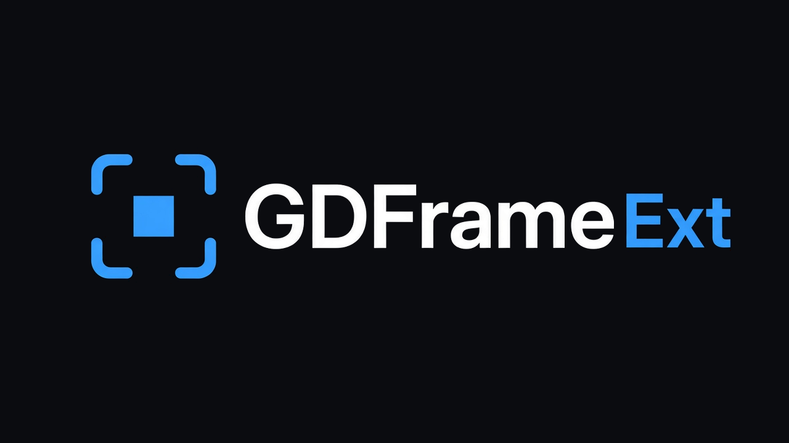

<p align="center">
  
</p>
<p align="center">
  <a href="LICENSE"></a>
  <a href="https://docs.godotengine.org/en/stable/tutorials/scripting/gdscript/index.html"></a>
  <a href="https://godotengine.org/"></a>
  <a href="https://github.com/ftyu3d/gdframe/stargazers"></a>
</p>

# GDFrame Ext

**GDFrame 的可选能力扩展**——可配置流总线、手柄震动与输入改键等模块，按需安装到 **`res://addons/gdframe_<id>/`**。

仓库：[GitHub](https://github.com/ftyu3d/gdframe-ext) 或 [Gitee](https://gitee.com/ftyu3d/gdframe-ext)。须先启用 **GDFrame** 插件（[GitHub](https://github.com/ftyu3d/gdframe) 或 [Gitee](https://gitee.com/ftyu3d/gdframe)）。

## 扩展

| 扩展 | 说明 | 文档 |
|------|------|------|
| **stream_bus** | 可配置流总线（默认 BGS、Voice） | [addons/gdframe_stream_bus/editor/README.md](addons/gdframe_stream_bus/editor/README.md) |
| **rumble** | 手柄震动开关与振动（`GDFrame.rumble`） | [addons/gdframe_rumble/editor/README.md](addons/gdframe_rumble/editor/README.md) |
| **input_remap** | 玩法 action 改键（`GDFrameInputRemap`） | [addons/gdframe_input_remap/editor/README.md](addons/gdframe_input_remap/editor/README.md) |

## 安装

1. 在 Godot 项目中启用 **GDFrame** 插件。
2. 打开编辑器 Dock → **扩展管理**，安装所需扩展。
3. 点击 **生成扩展 API**，同步服务槽位 / profile / 信号。

也可从 [GitHub Releases](https://github.com/ftyu3d/gdframe-ext/releases) 或 [Gitee Releases](https://gitee.com/ftyu3d/gdframe-ext/releases) 下载 **`<id>.zip`**（如 `stream_bus.zip`）解压到工程根；或将本仓库中对应目录（如 `addons/gdframe_stream_bus/`）复制到工程的 `res://addons/gdframe_stream_bus/`。

```powershell
powershell -ExecutionPolicy Bypass -File tools/pack_release.ps1
# 或单个：powershell -ExecutionPolicy Bypass -File tools/pack_release.ps1 -ExtId stream_bus
# 或 Windows: .\tools\pack_release.bat
# 或 macOS/Linux: ./tools/pack_release.sh
```

产出 `dist/<id>.zip`（内含 `addons/gdframe_<id>/...`，解压到工程根目录）。

## 调用约定

有服务槽位的扩展：业务直调 **`GDFrame.<模块>.方法()`**（如 `GDFrame.rumble.rumble()`）。

**stream_bus** 的轨方法在 **`GDFrame.audio`** 上（如 `GDFrame.audio.play_bgs(stream)`）。Dock「流总线」页点 **生成** 写入轨名并生成这些方法；扩展管理 **生成扩展 API** 按已保存轨名生成同一份。

无服务槽位的扩展（如 **input_remap**）使用独立 `class_name` API，见各模块 README。

## 许可证

[MIT](LICENSE) © Feng Yang
